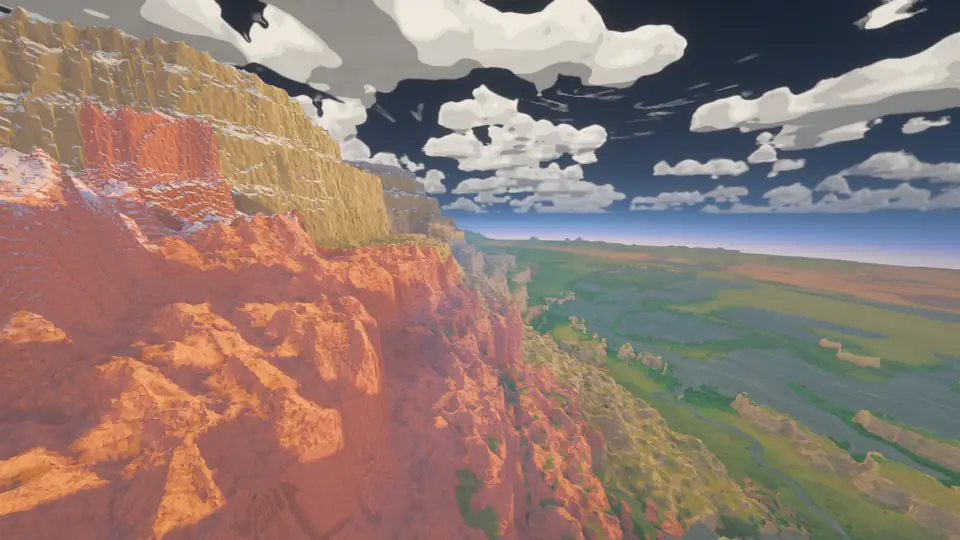

# ochre

[](#license)
[](https://bevy.org/)
[](https://rustup.rs/)

Ochre is a procedural wilderness engine built with Rust and Bevy, designed to bring vast, beautiful and untamed natural worlds to life.



[](https://www.youtube.com/watch?v=XzNtVPHNxGw])

## Run it

A simple sandbox example is included to showcase atmospheric audio, foliage, water and basic weather.

```
cargo run --release --example sandbox
```

## History

I started ochre, originally named rustcraft, back in 2021 as an experiment to build a Minecraft clone using Rust, [specs](https://github.com/amethyst/specs) and [glium](https://github.com/glium/glium).

In 2023, I migrated the project over to [Bevy](https://bevy.org/) because I wanted to push render distance out further and got bored of fiddling around with a custom rendering pipeline.

Then I abandoned the project for a while, before coming back in 2026 with renewed interest and Claude Code at my disposal to massively speed up delivery of new features. Since then, I've completed my unfinished octree level of detail (LOD) implementation, revamped terrain generation and beautified the rendering from the old look.

July 2026:


## License

Licensed under either of

- Apache License, Version 2.0
  ([LICENSE-APACHE](LICENSE-APACHE) or <http://www.apache.org/licenses/LICENSE-2.0>)
- MIT license
  ([LICENSE-MIT](LICENSE-MIT) or <http://opensource.org/licenses/MIT>)

at your option.

## Contribution

Issues for bugs and ideas are welcome. Please open an issue to discuss any non-trivial change **before** opening a pull request; large or unsolicited PRs will likely be closed. See [CONTRIBUTING.md](CONTRIBUTING.md) for details.

Unless you explicitly state otherwise, any contribution intentionally submitted
for inclusion in the work by you, as defined in the Apache-2.0 license, shall be
dual licensed as above, without any additional terms or conditions.
